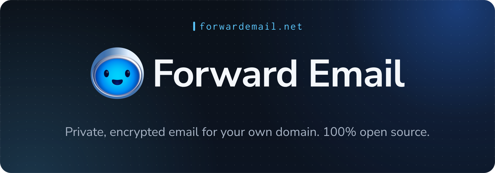
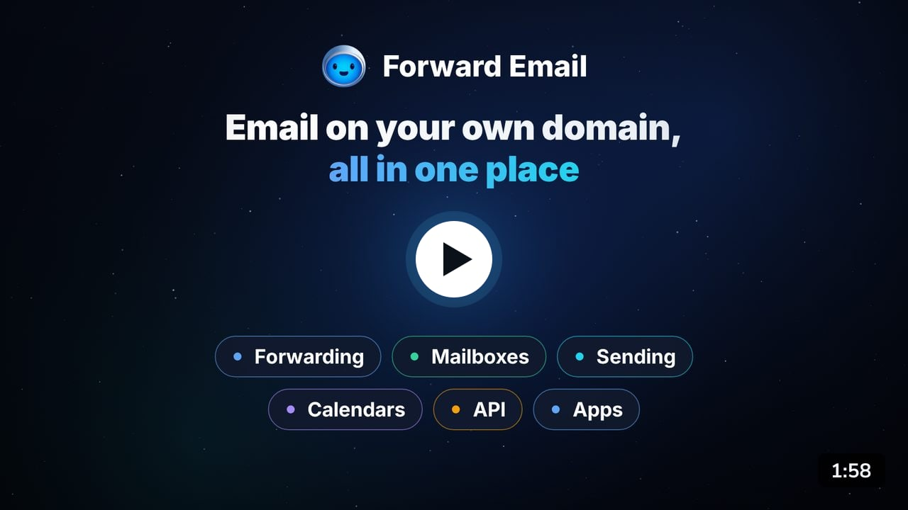

<!-- 🐾 Rest in Peace, Jack (2014-2025) -->

<h1 align="center">
  <a href="https://forwardemail.net"></a>
</h1>

<p align="center">
  <a href="https://github.com/forwardemail/forwardemail.net/actions/workflows/ci.yml"></a>
  <a href="https://github.com/sindresorhus/xo"></a>
  <a href="https://github.com/prettier/prettier"></a>
  <a href="https://github.com/forwardemail/forwardemail.net/blob/master/LICENSE.md"></a>
</p>

<p align="center">
  <a href="https://forwardemail.net/register"><strong>Start free</strong></a>
  &nbsp;·&nbsp;
  <a href="https://forwardemail.net/#video">Watch the tour</a>
  &nbsp;·&nbsp;
  <a href="https://forwardemail.net/private-business-email">Pricing</a>
  &nbsp;·&nbsp;
  <a href="https://forwardemail.net/download">Apps</a>
  &nbsp;·&nbsp;
  <a href="https://forwardemail.net/faq">FAQ</a>
  &nbsp;·&nbsp;
  <a href="https://forwardemail.net/email-api">API</a>
  &nbsp;·&nbsp;
  <a href="https://forwardemail.net/self-hosted">Self-host</a>
</p>

**[Forward Email](https://forwardemail.net)** is a 100% open-source, privacy-focused email service for custom domains. Point your domain at us and you get `you@yourdomain.com` in a few minutes. Forward that mail to Gmail, Outlook, iCloud, or any inbox you already use, for free. When you want more, upgrade to encrypted mailboxes that work in Apple Mail, Outlook, Thunderbird, and our own apps.

This repository is the code that runs the service: the website, the API, and every mail server. You can read it, audit it, and run it on your own server.


## Table of Contents

* [Start here](#start-here)
* [Watch the 2-minute tour](#watch-the-2-minute-tour)
* [What you get](#what-you-get)
  * [Email at your own domain](#email-at-your-own-domain)
  * [Private by design](#private-by-design)
  * [Works on your devices](#works-on-your-devices)
  * [Built for developers](#built-for-developers)
* [Plans](#plans)
* [Who uses Forward Email](#who-uses-forward-email)
* [Why open source](#why-open-source)
* [What's in this repository](#whats-in-this-repository)
* [Related projects](#related-projects)
* [Developer guide](#developer-guide)
  * [Requirements](#requirements)
  * [Run it locally](#run-it-locally)
  * [Run the tests](#run-the-tests)
  * [Push notifications](#push-notifications)
  * [Production deployment](#production-deployment)
  * [Spam Scanner](#spam-scanner)
* [Get help](#get-help)
* [Security](#security)
* [Contributing](#contributing)
* [License](#license)


## Start here

Find what you want to do in the left column and follow the link.

| I want to…                                            | Go here                                                                                                            |
| ----------------------------------------------------- | ------------------------------------------------------------------------------------------------------------------ |
| Get email at my own domain (no coding)                | [Create a free account](https://forwardemail.net/register)                                                         |
| Forward my domain's mail to Gmail, Outlook, or iCloud | [Step-by-step setup](https://forwardemail.net/faq#how-do-i-get-started-and-set-up-email-forwarding)                |
| Send mail as `me@mydomain.com` from Gmail             | [Send Mail As with Gmail](https://forwardemail.net/guides/send-mail-as-gmail-custom-domain)                        |
| Set up Apple Mail, Outlook, Thunderbird, or my phone  | [Email client setup guides](https://forwardemail.net/guides)                                                       |
| Read my mail in an app                                | [Download the apps](https://forwardemail.net/download)                                                             |
| Compare plans and prices                              | [Pricing](https://forwardemail.net/private-business-email)                                                         |
| Send email from my app or website                     | [Email API](https://forwardemail.net/email-api) and [SMTP guide](https://forwardemail.net/guides/smtp-integration) |
| Run Forward Email on my own server                    | [Self-hosting guide](self-hosting/README.md)                                                                       |
| Check if the service is up                            | [status.forwardemail.net](https://status.forwardemail.net)                                                         |
| Ask a question or get help                            | [FAQ](https://forwardemail.net/faq) or [Get help](#get-help)                                                       |
| Report a security issue                               | [Security](#security)                                                                                              |
| Work on this code                                     | [Developer guide](#developer-guide)                                                                                |


## Watch the 2-minute tour

<p align="center">
  <a href="https://forwardemail.net/#video"></a>
</p>

Click the picture to play the video on [forwardemail.net](https://forwardemail.net/#video). It has captions, so you can watch with the sound off.


## What you get

### Email at your own domain

* Unlimited domains on every plan, and unlimited aliases on paid plans, with no per-user fees.
* Forward mail to any inbox, or keep it in an encrypted mailbox with 10 GB of storage.
* Catch-all addresses, regex filters, [disposable addresses](https://forwardemail.net/disposable-addresses), and webhooks.
* Send as your domain over SMTP, with SPF, DKIM, DMARC, MTA-STS, and DANE support.
* Set up your DNS records in one click at supported providers with [Domain Connect](https://forwardemail.net/domain-connect).

### Private by design

* We process forwarded mail in memory and never write it to disk.
* Each mailbox is its own encrypted SQLite file that only your password can open.
* Quantum-resistant encryption, plus [OpenPGP and Web Key Directory (WKD)](https://forwardemail.net/faq#do-you-support-openpgpmime-end-to-end-encryption-e2ee-and-web-key-directory-wkd) support.
* No third-party analytics or telemetry. Read our [privacy policy](https://forwardemail.net/privacy) for the details.

### Works on your devices

* Use any email client over IMAP, POP3, and SMTP: Apple Mail, Gmail, Outlook, Thunderbird, and more.
* Sync calendars and contacts over CalDAV and CardDAV.
* Let email clients find your server settings on their own with [autodiscovery](https://forwardemail.net/faq#how-do-i-set-up-email-autodiscovery-for-my-domain).
* Use [our open-source apps](https://github.com/forwardemail/mail.forwardemail.net) in a browser, on desktop and mobile, or in your terminal.
* Write mail filters with Sieve and manage them over ManageSieve.

### Built for developers

* Everything the dashboard does is a [REST API](https://forwardemail.net/email-api) call.
* Receive mail as JSON [webhooks](https://forwardemail.net/faq#do-you-support-webhooks).
* Send over SMTP or the API. Your daily sending limit grows with your sender reputation.
* Connect AI assistants with the [MCP server](https://github.com/forwardemail/mcp-server), or manage domains with the [Terraform provider](https://github.com/forwardemail/terraform-provider-forwardemail).
* [Self-host](https://forwardemail.net/self-hosted) the whole stack with Docker.


## Plans

| Plan                    | Price   | Good for                                                                                                       |
| ----------------------- | ------- | -------------------------------------------------------------------------------------------------------------- |
| **Free**                | $0      | Forwarding mail from your domain to an inbox you already have                                                  |
| **Enhanced Protection** | $3/mo   | Sending and receiving as `you@yourdomain.com`, with unlimited aliases, 10 GB of storage, the apps, and the API |
| **Team**                | $9/mo   | Families and organizations: unlimited team members, permissions, and priority support                          |
| **Enterprise**          | $250/mo | Education, government, and healthcare, with dedicated support and onboarding                                   |

Every plan includes unlimited domains. See [pricing](https://forwardemail.net/private-business-email) for the full comparison.


## Who uses Forward Email

More than 1.6 million domains use Forward Email, including:

* **Open source:** The Linux Foundation, Ubuntu, Canonical, jQuery, and LineageOS
* **Education:** University of Cambridge, Carnegie Mellon, University of Maryland, Tufts, and Swarthmore
* **Government:** US Naval Academy, Government of South Australia, and Government of the Dominican Republic
* **Business:** Netflix Games, Disney Ad Sales, Fox News Radio, and RCD Hotels

Read the case studies for [The Linux Foundation](https://forwardemail.net/blog/docs/linux-foundation-email-enterprise-case-study), [Canonical and Ubuntu](https://forwardemail.net/blog/docs/canonical-ubuntu-email-enterprise-case-study), and [university alumni email](https://forwardemail.net/blog/docs/alumni-email-forwarding-university-case-study).


## Why open source

Your email holds your most private conversations. You shouldn't have to take a company's word for what happens to it. Every line of code that runs Forward Email lives in this repository, so you, or anyone you trust, can check our privacy claims against the code.

* [Why open-source email matters](https://forwardemail.net/blog/docs/why-open-source-email-security-privacy)
* [Technical whitepaper](https://forwardemail.net/technical-whitepaper.pdf)
* [Security practices](https://forwardemail.net/security)
* [Privacy policy](https://forwardemail.net/privacy)


## What's in this repository

Forward Email runs as a set of small Node.js services. Each one has an entry point in the root of this repository:

| Service     | What it does                                             | Start it locally      | Local port |
| ----------- | -------------------------------------------------------- | --------------------- | :--------: |
| Web         | Website and dashboard                                    | `npm start web`       |   `3000`   |
| API         | REST API used by the dashboard, the apps, and developers | `npm start api`       |   `4000`   |
| MX          | Receives inbound mail, filters spam, and forwards it     | `npm start mx`        |   `2525`   |
| SMTP        | Sends outbound mail for users                            | `npm start smtp`      |   `2432`   |
| IMAP        | Mailbox access for email clients                         | `npm start imap`      |   `2113`   |
| POP3        | Mailbox download for email clients                       | `npm start pop3`      |   `2115`   |
| SQLite      | Stores each mailbox in its own encrypted SQLite file     | `npm start sqlite`    |   `3456`   |
| CalDAV      | Calendar sync                                            | `npm start caldav`    |   `5000`   |
| CardDAV     | Contact sync                                             | `npm start carddav`   |   `6000`   |
| ManageSieve | Mail filter management for email clients                 | `node managesieve.js` |   `4190`   |
| Bree        | Background jobs (billing, reports, cleanup, and checks)  | `npm start bree`      |    None    |

The rest of the code lives in these folders:

| Folder                         | Contents                                                       |
| ------------------------------ | -------------------------------------------------------------- |
| [`app`](app)                   | Models, controllers, and Pug views for the website and the API |
| [`helpers`](helpers)           | Shared code used by every service                              |
| [`jobs`](jobs)                 | Background jobs run by Bree                                    |
| [`config`](config)             | Configuration and environment defaults                         |
| [`routes`](routes)             | Website and API routes                                         |
| [`emails`](emails)             | Templates for the emails we send you                           |
| [`locales`](locales)           | Translations                                                   |
| [`test`](test)                 | Test suite                                                     |
| [`ansible`](ansible)           | Server provisioning playbooks                                  |
| [`self-hosting`](self-hosting) | Docker setup for running your own instance                     |


## Related projects

| Repository                                                                                                          | What it is                                             |
| ------------------------------------------------------------------------------------------------------------------- | ------------------------------------------------------ |
| [mail.forwardemail.net](https://github.com/forwardemail/mail.forwardemail.net)                                      | Webmail, desktop, mobile, and terminal apps            |
| [mcp-server](https://github.com/forwardemail/mcp-server)                                                            | MCP server that connects AI assistants to your account |
| [terraform-provider-forwardemail](https://github.com/forwardemail/terraform-provider-forwardemail)                  | Manage domains and aliases with Terraform              |
| [forwardemail-api-go](https://github.com/forwardemail/forwardemail-api-go)                                          | Go client for the API                                  |
| [status.forwardemail.net](https://github.com/forwardemail/status.forwardemail.net)                                  | Status page                                            |
| [spamscanner](https://github.com/spamscanner/spamscanner)                                                           | Our open-source spam and phishing filter               |
| [bree](https://github.com/breejs/bree)                                                                              | Job scheduler for Node.js                              |
| [tangerine](https://github.com/forwardemail/tangerine)                                                              | DNS over HTTPS resolver for Node.js                    |
| [caldav-adapter](https://github.com/forwardemail/caldav-adapter)                                                    | CalDAV server for Node.js and Koa                      |
| [email-templates](https://github.com/forwardemail/email-templates)                                                  | Create, preview, and send email templates from Node.js |
| [supertest](https://github.com/forwardemail/supertest) and [superagent](https://github.com/forwardemail/superagent) | HTTP testing and client libraries we maintain          |

See [all of our repositories](https://github.com/forwardemail).


## Developer guide

### Requirements

#### macOS

1. Install [n][] and Node v18.20.4:

   ```sh
   curl -L https://raw.githubusercontent.com/mklement0/n-install/stable/bin/n-install | bash -s -- -y 18.20.4
   ```

2. Make sure you are running Node v18.20.4:

   ```sh
   node --version
   v18.20.4
   ```

3. Install [brew][] and the following dependencies using the `brew` command:

   ```sh
   brew tap mongodb/brew
   brew install mongodb-community redis libtool automake autoconf nasm
   brew services start mongodb-community
   brew services start redis
   ```

4. Install [pnpm][]:

   ```sh
   corepack enable
   corepack prepare pnpm@9.15.9 --activate
   ```

5. [Fork the repository on GitHub](https://github.com/forwardemail/forwardemail.net/fork).

6. Clone your fork (replace `YOUR_USERNAME` with your GitHub username):

   ```sh
   git clone git@github.com:YOUR_USERNAME/forwardemail.net.git
   cd forwardemail.net
   ```

7. Install [npm][] dependencies:

   ```sh
   pnpm install
   ```

8. Install [wkhtmltopdf](https://wkhtmltopdf.org/downloads.html#stable) (**optional:** only used for generating PDF receipts).

#### Ubuntu

1. Install [n][] and Node v18.20.4:

   ```sh
   curl -L https://raw.githubusercontent.com/mklement0/n-install/stable/bin/n-install | bash -s -- -y 18.20.4
   ```

2. Make sure you are running Node v18.20.4:

   ```sh
   node --version
   v18.20.4
   ```

3. Install [pnpm][]:

   ```sh
   corepack enable
   corepack prepare pnpm@9.15.9 --activate
   ```

4. [Fork the repository on GitHub](https://github.com/forwardemail/forwardemail.net/fork).

5. Clone your fork (replace `YOUR_USERNAME` with your GitHub username):

   ```sh
   git clone git@github.com:YOUR_USERNAME/forwardemail.net.git
   cd forwardemail.net
   ```

6. Install [npm][] dependencies:

   ```sh
   pnpm install
   ```

7. Install fonts:

   ```sh
   echo ttf-mscorefonts-installer msttcorefonts/accepted-mscorefonts-eula select true | sudo debconf-set-selections
   ```

   ```sh
   sudo apt-get install xfonts-75dpi fontconfig libxrender1 xfonts-base ttf-mscorefonts-installer libfontconfig fonts-powerline
   ```

8. Install [wkhtmltopdf](https://wkhtmltopdf.org/downloads.html#stable) (**optional:** only used for generating PDF receipts):

   ```sh
   wget "https://github.com/wkhtmltopdf/packaging/releases/download/0.12.6.1-2/wkhtmltox_0.12.6.1-2.$(lsb_release -c -s)_$(dpkg --print-architecture).deb"
   sudo dpkg -i "wkhtmltox_0.12.6.1-2.$(lsb_release -c -s)_$(dpkg --print-architecture).deb"
   ```

9. Install MongoDB by following the guide at <https://www.mongodb.com/docs/manual/tutorial/install-mongodb-on-ubuntu/#install-mongodb-community-edition>.

10. Install Redis by following the guide at <https://www.digitalocean.com/community/tutorials/how-to-install-and-secure-redis-on-ubuntu-20-04>.

### Run it locally

Once you have the [requirements](#requirements) installed, start the website:

```sh
npm start webAndWatch
```

It builds the assets, starts the web server, and opens <http://localhost:3000> in your browser. The terminal shows logs from [consola](https://github.com/unjs/consola).

Start any other service with the commands in [What's in this repository](#whats-in-this-repository). All of them use [nps](https://github.com/sezna/nps). To start the web, API, Bree, SMTP, IMAP, POP3, and SQLite servers at once:

```sh
npm start all
```

Local servers don't require TLS. You can connect to the local SMTP, IMAP, POP3, CalDAV, and CardDAV servers with [Thunderbird](https://www.thunderbird.net), `telnet`, or `openssl`.

If <http://localhost:3000> loads without styles or images, run the build first:

```sh
npm run build
```

To stop every Node process at once, run `killall node`.

### Run the tests

```sh
pnpm test
```

This lints the code, builds the assets, and runs the test suite. The tests start an in-memory MongoDB and a mock Redis, so you don't need either service running.

For verbose error logs, set these environment variables:

```sh
AXE_SILENT=false AXE_SHOW_STACK=true AXE_SHOW_META=true pnpm test
```

### Push notifications

[`PUSH_NOTIFICATIONS.md`](PUSH_NOTIFICATIONS.md) documents backend setup for APNs, FCM HTTP v1, and UnifiedPush. It explains how to get every environment value, deploy file-based credentials, copy the required public values to [`mail.forwardemail.net`](https://github.com/forwardemail/mail.forwardemail.net), and validate the setup.

APNs reuses the existing `APPLE_TEAM_ID`, `APPLE_KEY_ID`, and `APPLE_KEY_PATH` values used for Sign in with Apple. Do not create separate APNs-specific credential variables.

### Production deployment

[`DEPLOYMENT.md`](DEPLOYMENT.md) covers running Forward Email in production: server naming, provisioning with [Ansible][], deploying with [pm2][], certificates and DANE, bare metal setup, storage mirroring, and Domain Connect.

For server tuning, monitoring, and database operations, see [`ansible/README.md`](ansible/README.md).

To run a single-server instance with Docker instead, see the [self-hosting guide](self-hosting/README.md).

### Spam Scanner

[`SPAM_SCANNER.md`](SPAM_SCANNER.md) covers how inbound and outbound mail is scanned, monitor mode, domain settings, abuse reports, the local language model, every setting, and a runbook for deploying, checking, scaling, turning off, and leaving monitor mode.


## Get help

* **Answers:** [FAQ](https://forwardemail.net/faq) and [guides](https://forwardemail.net/guides)
* **Questions:** [GitHub Discussions](https://github.com/forwardemail/forwardemail.net/discussions)
* **Support:** <support@forwardemail.net> or [forwardemail.net/help](https://forwardemail.net/help)
* **Service status:** [status.forwardemail.net](https://status.forwardemail.net)
* **Bugs in this code:** [open an issue](https://github.com/forwardemail/forwardemail.net/issues)
* **Community:** [Matrix](https://matrix.to/#/#forwardemail:matrix.org), [X](https://x.com/fwdemail), and [YouTube](https://youtube.com/forwardemail)


## Security

Please don't report security issues in public issues, discussions, or pull requests. Email <security@forwardemail.net> instead. See [SECURITY.md](SECURITY.md), our [security page](https://forwardemail.net/security), and our signed [security.txt](https://forwardemail.net/security.txt).


## Contributing

We welcome bug reports and pull requests. Before you open a pull request:

1. Follow the [developer guide](#developer-guide) to set up the project.
2. Write commit messages in the [Conventional Commits](https://www.conventionalcommits.org) format.
3. Run `pnpm test` and make sure it passes.


## License

[(BUSL-1.1 AND MPL-2.0)](LICENSE.md) © [Forward Email LLC](https://forwardemail.net)


##

<div align="center"><a href="https://forwardemail.net"></a></div>

[ansible]: https://github.com/ansible/ansible

[brew]: https://brew.sh/

[n]: https://github.com/tj/n

[pm2]: https://github.com/Unitech/pm2

[npm]: https://www.npmjs.com

[pnpm]: https://github.com/pnpm/pnpm
